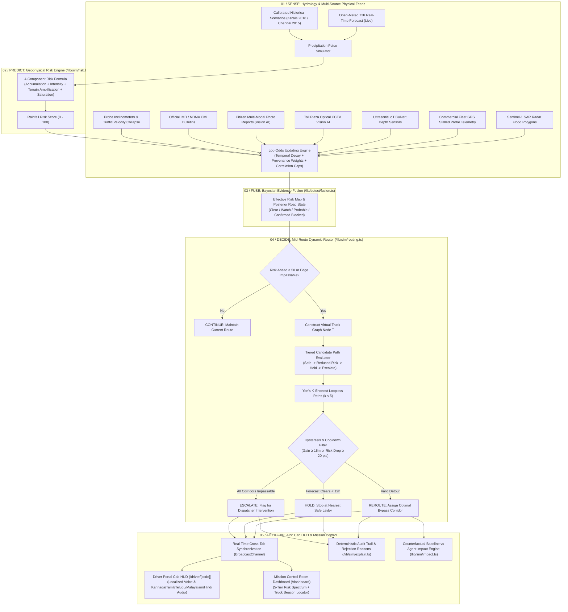

# ResilienceOps: Autonomous Climate-Resilient Supply Chain & Physical Infrastructure Agent

[](https://github.com/Dhanushcr18/Climate-resilience-and-supply-infrastructure)
[](https://github.com/Dhanushcr18/Climate-resilience-and-supply-infrastructure)
[-black.svg)](https://nextjs.org/)
[](https://www.typescriptlang.org/)
[](LICENSE)

> **Predict road failures *before* they happen. Reroute life-critical cargo in real time.**  
> An autonomous, closed-loop resilience intelligence agent for commercial supply chains, multimodal freight networks, and disaster relief logistics during extreme meteorological disruptions.

---

## 1. Executive Summary & Problem Statement

Extreme hydrological events—such as monsoon cloudbursts across the Western Ghats and urban storm surges along the Coromandel coastline—inflict sudden, catastrophic disruptions on national highway lifelines.

Today's commercial logistics infrastructure operates **purely reactively**:
1. **Blind Dispatching:** Fleets are dispatched along static, shortest-distance routes based solely on clear-weather baselines.
2. **Point-of-Failure Discovery:** Drivers encounter impassable mudslides, flooded causeways, or culvert breaches only when they arrive at the physical obstruction, leaving them trapped without escape routes.
3. **Spoilage & localized humanitarian crises:** Life-critical supplies (temperature-sensitive insulin, plasma, cold-chain vaccines, infant nutrition, generator fuels) spoil in stranded bottlenecks, while relief hubs face severe localized stockouts.

**ResilienceOps** transforms reactive logistics into a predictive, autonomous closed-loop control system:
$$\text{SENSE} \longrightarrow \text{PREDICT} \longrightarrow \text{DETECT \& FUSE} \longrightarrow \text{DECIDE} \longrightarrow \text{ACT} \longrightarrow \text{EXPLAIN}$$

The agent continuously evaluates 24-hour rainfall history and forecasts, fuses **9 independent physical detection feeds** via Bayesian log-odds, computes mid-route dynamic detours using a virtual truck graph view, enforces turn-back safety on hazardous ghat passes, and coordinates regional dispatch in real time across India.

---

## 2. Core Architectural System Loop



---

## 3. Key Features & Innovations

### A. Mid-Route Dynamic Re-planning with Virtual Truck Nodes
When a road closes while a truck is already in transit (e.g., 40% along Hassan to Mangaluru on NH75 Shiradi Ghat), the router does not restart from the origin city or previous hub:
- **Temporary Virtual Node ($T$):** The system dynamically splits the current edge into two links without mutating the underlying road graph:
  - $T \to \text{forwardNode}$ with cost $(1 - f) \times \text{time}$
  - $T \to \text{prevNode}$ with cost $f \times \text{time}$ (reverse turnaround)
- **Turn-Back Geometry Restrictions:** Steep, single-lane ghat corridors (`HAS-MNG`, `WYN-KZD`, `MDK-MNG`) are flagged with `canTurnBack: false`. Heavy trucks are physically prohibited from performing dangerous U-turns on narrow mountain passes unless within the entry gate rotary ($\le 10\%$).
- **Safe Stop Emergency Laybys:** `safeStopPoints` fractions (e.g. $[0.30, 0.70]$) designate mountain pull-overs where a truck can safely hold without blocking traffic or risking mudslide exposure.
- **Traversal-Time Aware Dijkstra:** Evaluates edge costs and road passability at the truck's *projected arrival hour* ($tEnter = t_{\text{decision}} + \text{cumulativeMin}/60$).
- **Yen's K-Shortest Loopless Alternatives ($k \le 5$):** Generates ranked alternative corridors, each carrying transparent operational reasons for acceptance or rejection.
- **Anti-Flip-Flopping Hysteresis:** Enforces `REPLAN_COOLDOWN_MIN = 30` minutes and minimum thresholds (`REPLAN_MIN_GAIN_MIN = 15` min or `REPLAN_MIN_RISK_DROP = 20` points) to prevent trucks from oscillating between routes. Emergency road closures immediately override cooldowns.

### B. 9-Source Bayesian Multi-Modal Evidence Fusion
Replaces brittle single-sensor rules with a robust Bayesian log-odds engine:
1. **Rainfall Hydrological Prior:** Physical 4-component risk formula (accumulation, intensity, terrain vulnerability multiplier, soil saturation bonus).
2. **Sentinel-1 SAR Radar:** Synthetic aperture radar flood polygons providing wide-area inundation proof.
3. **Fleet GPS Telemetry:** Detects clusters of $\ge 3$ commercial vehicles stalled for $\ge 20$ minutes ($< 15\%$ nominal speed).
4. **Ultrasonic IoT Culvert Sensors:** Detects stream overtopping ($\ge 30$ cm depth over roadway).
5. **Macroscopic Traffic Velocity:** Tracks regional flow collapses along major corridors.
6. **Fixed CCTV Optical Classifiers:** AI camera streams classifying road spray, ponding, or active debris flows.
7. **Official Meteorological Bulletins:** Civil red/orange advisories issued by IMD/NDMA.
8. **Citizen Photo Reports:** Multimodal Vision AI classifying real-time user-uploaded road hazards.
9. **Field Human Intel:** Verified on-site reports by highway patrol units and emergency dispatchers.

*Key Guardrail:* Traffic slow-downs (`claim: "degraded"`) prove vehicles are still actively moving and cannot falsely trigger a confirmed road closure. Physical closures require multi-source cross-validation or human field verification.

### C. 5-Tier Semantic Color Spectrum
Ensures logistics operators instantly discern between high-hazard weather and true impassable closures:
- **Low Risk ($< 25$):** Emerald Green (`#10b981`) — Normal free-flow conditions.
- **Moderate Risk ($25 - 49$):** Royal Blue (`#3b82f6`) — Light to moderate rainfall; open.
- **High Risk ($50 - 74$):** Caution Amber (`#e0a100`) — Heavy precipitation; open with reduced speeds.
- **Severe Caution ($75 - 84$):** Burnt Orange (`#ea580c`) — Extreme weather alert; open with high caution.
- **Closed / Blocked ($\ge 85$ or Confirmed):** Deep Red (`#ba1a1a`, dashed line) — Physical obstruction; strictly impassable.

### D. Pan-India Grid & Multilingual Driver Cab Portal
- **Zone-Wise Filtering:** Operational views split into **All India, South India, North India, West India, and East India**.
- **Localized Multilingual Interface:** Native languages for drivers based on region:
  - **South India:** Kannada (ಕನ್ನಡ), Tamil (தமிழ்), Telugu (తెలుగు), Malayalam (മലയാളം), English.
  - **Other Zones:** Hindi (हिन्दी), English.
- **Audio Speech Synthesis:** Web Speech API voice synthesis delivers turn-by-turn spoken directives directly into the driver's cab.
- **Cross-Tab Synchronization:** Bidirectional `BroadcastChannel` keeps the Mission Control Room and Driver Portal HUD locked in real time without polling.

---

## 4. Tech Stack

- **Framework:** Next.js 14 (App Router, Server Components & Route Handlers)
- **Language:** TypeScript 5.6 (Strict Type Checking)
- **Styling & Design System:** Tailwind CSS, Lucide Icons, Material Symbols, Framer Motion
- **Spatial GIS:** Leaflet & React-Leaflet (dynamic client-side rendering with custom high-contrast DivIcons)
- **State Management:** Zustand with local broadcast synchronization
- **Optimization:** Built-in multi-objective heuristic solver + NVIDIA CuOpt NIM integration
- **Test Suite:** Vitest (12 comprehensive suites, 71 unit and integration tests)
- **External APIs (Optional Enhancements):** Open-Meteo (real-time weather with in-memory caching), Google Gemini 2.0 Flash (transparent explanation generation)

---

## 5. Repository Structure

```
.
├── app/
│   ├── api/                     # API routes (explain, optimize, forecast, vision)
│   ├── dashboard/               # Mission Control Room dispatch dashboard
│   ├── driver/[code]/           # Driver Cab Portal HUD (multilingual voice UI)
│   ├── impact/                  # Counterfactual baseline vs agent impact metrics
│   ├── report/                  # Multi-source road incident reporting portal
│   └── page.tsx                 # Landing page & navigation hub
├── components/
│   ├── ControlRoomDrawer.tsx    # Operational decision audit drawer & candidate comparisons
│   ├── ControlRoomTimeBar.tsx   # 72-hour playback timeline controller
│   ├── DriverCabHud.tsx         # In-cab driver telemetry HUD with voice synthesis
│   └── Map/
│       ├── LeafletMap.tsx       # Leaflet GIS map with 5-tier spectrum & dynamic bypass overlays
│       ├── TruckMarkers.tsx     # High-visibility pulsating truck markers with locator beacons
│       └── LayersControl.tsx    # Fused rings, radar polygons, CCTV, and layby layer toggles
├── lib/
│   ├── detect/                  # 9-source Bayesian evidence fusion engine & simulators
│   │   ├── fusion.ts            # Bayesian log-odds fusion core
│   │   ├── agent.ts             # Effective risk map builder
│   │   └── simulators/          # Simulators for satellite, GPS, CCTV, sensors, alerts
│   ├── optimizer/               # Multi-stop routing solver (builtin heuristic & CuOpt)
│   ├── sim/
│   │   ├── engine.ts            # Deterministic discrete-event simulation engine
│   │   ├── network.ts           # Pan-India corridor graph (nodes, edges, ghat laybys)
│   │   ├── risk.ts              # 4-component hydrological risk scoring formula
│   │   ├── routing.ts           # Dijkstra, Yen's K-Shortest, Virtual Truck Node, Hysteresis
│   │   ├── scenarios.ts         # Calibrated rainfall scenarios (Kerala 2018, Chennai 2015, Live)
│   │   ├── shipments.ts         # Seeded critical cold-chain & emergency relief cargo
│   │   └── tieredRouting.ts     # Safe, Reduced Risk, Hold, and Escalate decision logic
│   └── store.ts                 # Zustand cross-tab synchronized simulation store
└── tests/                       # 12 test suites (routing, risk, fusion, mid-route, impact, etc.)
```

### Shared Server Database

Control-room reports, reopened roads, simulation time, manual reroutes, and driver acknowledgements are persisted by the server at:

- API: `GET/PUT/DELETE /api/simulation-state`
- Default local database file: `data/simulation-state.json`
- Optional override: `SIMULATION_DATABASE_PATH=/absolute/path/to/state.json`

The browser also retains a localStorage fallback, but the server database is the source used to synchronize the dashboard and driver portals after refresh or across tabs. The default file-backed database is intended for local/self-hosted deployment. A serverless host with an ephemeral filesystem (for example, a stateless Vercel deployment) should use a managed persistent database and replace `lib/database/simulation.ts`.

### Supabase shared database setup

Install the Supabase packages and set these variables on the server or `.env.local`:

```text
NEXT_PUBLIC_SUPABASE_URL=https://grruijklfriizvudeane.supabase.co
NEXT_PUBLIC_SUPABASE_PUBLISHABLE_KEY=<your-publishable-key>
SUPABASE_SERVICE_ROLE_KEY=<optional-server-only-key>
```

Apply `supabase/migrations/20261122100000_create_simulation_state.sql` in the Supabase SQL editor or through the Supabase CLI. Once configured, `/api/simulation-state` writes to Supabase first and keeps the file database only as an offline fallback. A Render persistent disk is not required when Supabase is configured.

---

## 6. Quickstart: Running Locally

The entire system is designed to run **100% offline with zero external dependencies or API keys required**. All physical models, scenarios, and optimization algorithms run deterministically in TypeScript.

### Prerequisites
- Node.js $\ge 18.18.0$
- npm $\ge 9.0.0$

### Step 1: Clone the Repository
```bash
git clone https://github.com/Dhanushcr18/Climate-resilience-and-supply-infrastructure.git
cd Climate-resilience-and-supply-infrastructure
```

### Step 2: Install Dependencies
```bash
npm install
```

### Step 3: Run the Test Suite
Verify that all 71 unit, integration, and scenario tests pass:
```bash
npm run test
```

### Step 4: Run the Development Server
```bash
npm run dev
```

Open [http://localhost:3000](http://localhost:3000) in your browser:
- **Mission Control Room:** `http://localhost:3000/dashboard`
- **Driver Portal (TRK-001):** `http://localhost:3000/driver/TRK-001`
- **Driver Portal (TRK-002):** `http://localhost:3000/driver/TRK-002`
- **Incident Reporting:** `http://localhost:3000/report`
- **Counterfactual Impact Metrics:** `http://localhost:3000/impact`

---

## 7. Automated Testing & Verification

The project enforces deterministic execution with **12 comprehensive Vitest test suites (71 tests)**:

| Test Suite | Purpose | Tests |
| :--- | :--- | :---: |
| `tests/routing.test.ts` | Dijkstra algorithm, edge avoidance, cost penalty calculations | 5 |
| `tests/geo.test.ts` | Haversine geodesics, midpoint calculations, bearing math | 6 |
| `tests/risk.test.ts` | Boundary thresholds (20mm, 200mm), intensity bounds, terrain multipliers | 7 |
| `tests/import-extract.test.ts` | Field incident parser and multi-source observation extractor | 3 |
| `tests/detection-simulators.test.ts` | Determinism and latency compliance across all 9 simulators | 7 |
| `tests/tiered-routing.test.ts` | Tier 1 (Safe) to Tier 4 (Escalate) selection and traversal time windows | 7 |
| `tests/engine.test.ts` | Discrete-event simulation determinism and state evolution | 4 |
| `tests/mid-route.test.ts` | Virtual truck node split, turn-back restrictions, Yen's k-shortest, hysteresis | 9 |
| `tests/optimizer.test.ts` | Heuristic vehicle assignment, capacity constraints, time windows | 8 |
| `tests/fusion.test.ts` | Bayesian log-odds fusion monotonicity, decay half-life, contradiction resolution | 8 |
| `tests/impact.test.ts` | Counterfactual comparison proving agent delay is strictly less than baseline | 3 |
| `tests/vision-report.test.ts` | User incident injection, computer vision classification, road reopening | 4 |
| **Total** | | **71 Passed** |

---

## 8. License

Distributed under the **MIT License**. See `LICENSE` for more information.
